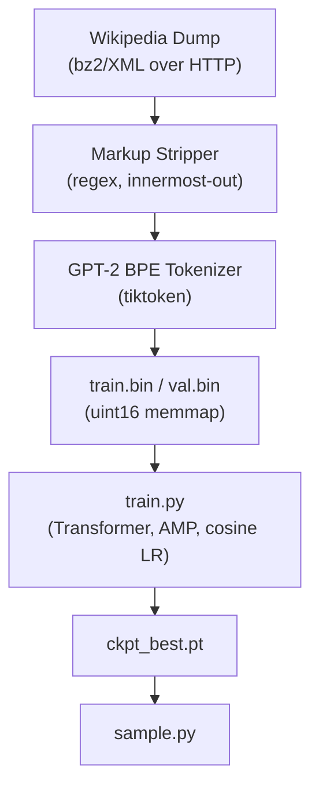
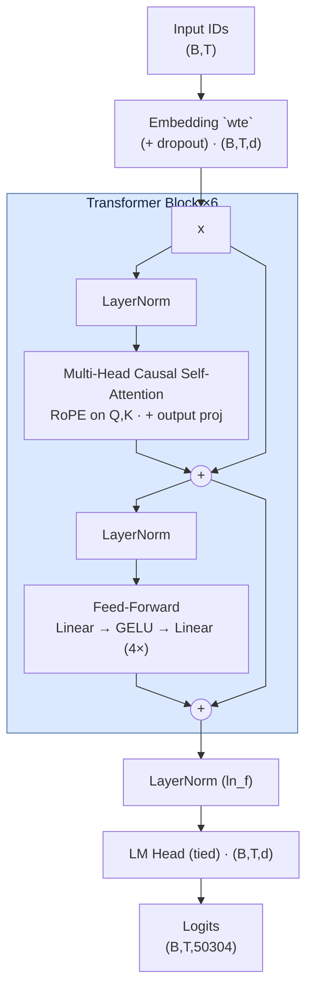
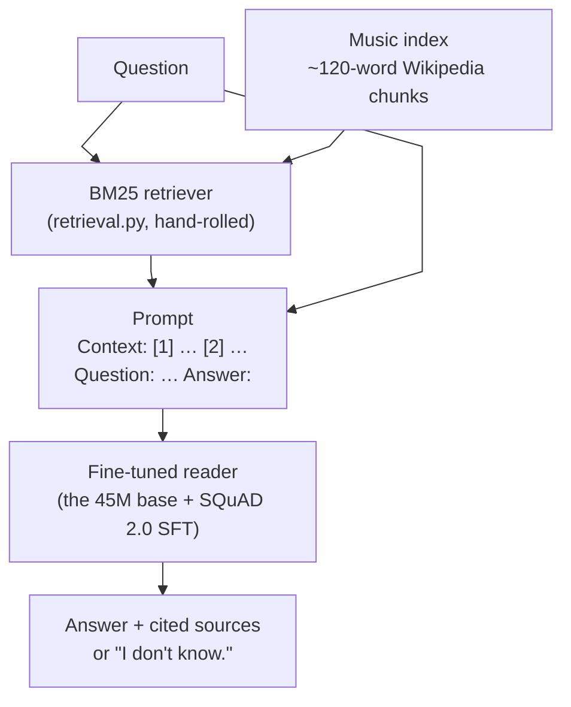

# musicGPT: a ~45M-parameter language model from scratch

This project was made to demonstrate that I understand what's inside an LLM, not that I can call one. Every core piece is written by hand rather than imported.

A decoder-only transformer built and trained end-to-end, with every core
piece written by hand instead of imported. The attention math, rotary
positional embeddings, layer norm, weight init, training loop, and even
the Wikipedia-markup stripper are hand-rolled.

A second stage turns the base model into a **grounded music Q&A model**: a
supervised fine-tune on SQuAD 2.0, so it answers questions (or says "I don't
know.") instead of continuing text, plus a hand-rolled BM25 retriever over
Wikipedia's music articles, so answers come from real passages rather than from
the model's memory. See [Fine-tuning + retrieval](#fine-tuning--retrieval).

**Model**
- 44.6M params (18.9M non-embedding), 6 layers, 8 heads, d=512
- 512-token context length
- GPT-2 BPE tokenizer via `tiktoken` (the one external component, see [trade-offs](#what-id-do-differently-at-scale))

**Training**
- ~0.92B tokens, streamed directly from official [Wikipedia dumps](https://dumps.wikimedia.org)
- Music-related articles upweighted 3× (Music and instruments are a major hobby of mine, so I wanted it this model to be good at music)
- One consumer GPU target; this run used Colab Pro (a single L4)

**Dependencies**
- `torch`, `numpy`, `tiktoken`, `requests`.

## Contents

- [Results](#results)
- [What broke](#what-broke)
- [Quickstart](#quickstart)
- [Repo layout](#repo-layout)
- [Architecture, and why](#architecture-and-why)
- [The data: Wikipedia, with a music bias](#the-data-wikipedia-with-a-music-bias)
- [Fine-tuning + retrieval](#fine-tuning--retrieval)
- [What I'd do differently at scale](#what-id-do-differently-at-scale)
- [References](#references)

## Repo Layout

```
model.py       the transformer: LayerNorm, RoPE, causal attention, blocks, generation
config.py      model presets (debug/small/base) + training hyperparameters
data.py        Wikipedia dump -> plain text -> GPT-2 BPE -> train.bin/val.bin
train.py       training loop: AMP, cosine LR, grad accumulation, eval, checkpoints, samples
sample.py      generate from a checkpoint (temperature / top-k / top-p)
plot_loss.py   metrics.csv -> loss_curve.png

qa_data.py     SQuAD 2.0 -> loss-masked Q&A examples (data/qa_*.bin), EM/F1 metrics
finetune.py    supervised fine-tune of ckpt_best.pt into a reader (answer-only loss)
retrieval.py   music articles -> ~120-word chunks -> hand-rolled BM25 index
ask.py         question -> retrieve -> answer + sources; --eval scorecard
eval/          hand-written music questions for the grounded-vs-ungrounded scorecard

tests/         correctness tests for the things that break silently
out/           plotting & training output (out/finetune/ for the Q&A stage)
```

## Results

Final run: 13,999 steps x 65,536 tokens/step ~= 0.92B tokens (the ~20
tokens/param budget for a 45M model), trained on Colab Pro (a single L4)
across several `--resume` sessions.


- **Init loss 10.9** = ln(50304), the uniform-guess baseline. Landing exactly
  there at step 0 is itself a correctness check (`tests/` asserts it).
- **Final loss: train 3.24, val 3.26** (val perplexity ~= 26), tracking each
  other tightly the whole run: no overfitting, despite ~1.9 passes over the
  690M-token corpus.
- **Throughput:** ~90k tokens/sec steady-state on the L4.

#### Sample output from `ckpt_best.pt` with prompt **'The electric guitar'**

> The electric guitar is a direct electric instrument; the other, which tends
> to be acoustic (not harmonically), while the rest of the material is a
> direct electric piano. In the concert band, this instrument typically
> features electric instruments.
>
> Instrumentation and programming
> The electric guitar has its own distinctive sound that involves creating
> "the dynamic range" of an ensemble or string section, being used in some
> music styles such as blues, R&B, soul-rock, black harmony, and
> electronic music. The technique is also used during recording and recording
> practice, where it can be performed with a variety of different effects. For
> example, when the performer performs in front of his audience, the vocalists
> can mimic the sounds of the instruments by placing them on one's notes (so
> their playing can produce one's own). When the singer uses fingerings from
> the solo over the strings, they can use hand pedals such as the pedal
> point.

> The electric guitar had a solid body. The main instrument the amp was on,
> with the same neck as the other instruments.
>
> **Early history (1690-1750)**
> Before that time, the amp used both its lower and upper parts. This era of
> playing became known by different names in English as "Old England Blues"
> or "New England Guitar". **In 1781, when Captain Richard Balfour died in
> London, he published his first song called The New American Blues**, which
> is still recorded today. It can be traced back to the original "Piper's
> Jug", a tune he had collected from the 1660s. From this point on, he
> experimented with the new, more acoustic guitars over a periodical, which he
> never played before so long. By then, he was producing and playing for
> **Charles Townshend's Sons Ltd.**, where he eventually established a
> publishing house at 35 Southwick Lane.

#### The bolded spans are wrong, and that's within the confines of this project.

**Explanation:** A 45M-param model trained on raw Wikipedia text with a
next-token-prediction objective (no fine-tuning, no retrieval, no
fact-checking signal) learns the shape of encyclopedic prose extremely
well: era headers, specific-sounding dates, named entities, because those
are dense statistical patterns in the training corpus. Nothing in the
training objective ever rewards a true date over a merely fluent-sounding
one, so the model reproduces the form of a Wikipedia article with none of
the grounding. That's the "completion model, not a chatbot" limit from
'Honest Expectations' below. The fix is the second stage of this repo,
[Fine-tuning + retrieval](#fine-tuning--retrieval): fine-tune the base on
human-verified Q&A pairs so "correct" becomes a real training signal, and
retrieve real passages so the facts come from Wikipedia instead of from
the model's memory.

**Errors in Output:** The electric guitar wasn't invented until the 1930s,
so a header reading "Early history (1690-1750)" is off by roughly two
centuries; "Captain Richard Balfour," "The New American Blues," "Charles
Townshend's Sons Ltd.," and "black harmony" are fluent, period-plausible
inventions that don't exist.

## What Broke

Real failures from building this:

1. **Weight tying leaks the current token into its own logits.** My init-loss
   sanity test ("an untrained model should score ~ln(V)") failed at 3.95 vs the
   expected 4.85. Cause: I'd used `targets=inputs`, i.e. asked the model
   to predict the token it was currently looking at, and with tied embeddings,
   position *t*'s hidden state starts as `wte[token_t]`, whose dot product with
   the tied output matrix is largest at… `token_t`. Even a random model "knows"
   what token it's standing on. The test now draws targets independently, and
   `tests/test_model.py::test_init_loss_near_uniform` documents it.

2. **Vocab padding crashes the tokenizer.** I padded the embedding to 50304
   for matmul speed; `tiktoken` only knows ids < 50257. An *untrained* model
   samples near-uniformly, so the very first checkpoint's sample generation hit
   a padding id and died with `KeyError: 50296`, mid-training-run, in the
   checkpoint code path. Fix: `generate(..., vocab_limit=50257)` masks the
   padding ids to −inf before sampling. Lesson: any id the model *can* emit is
   an id your decoder must handle, and "can emit" includes rows you never train.

3. **Wikitext is not one regex.** Templates nest (`{{cite {{...}}}}`), tables
   nest, and a single greedy pattern either under-strips (markup soup in the
   training data) or eats whole paragraphs. The stripper peels innermost
   constructs in a loop, and I keep a decode-and-eyeball check on the first
   tokens of `train.bin`, since markup that survives becomes what the model learns.

Other failures from the same silent category: fp16 without
GradScaler underflows gradients (auto-handled here: bf16 where supported,
scaler otherwise), and eval time polluting tokens/sec metrics (timer resets
after eval). Also practical: if this repo lives in OneDrive/Dropbox, exclude
`out/` and `data/` from sync: a 1GB memmap being re-uploaded every 500 steps
while checkpoints write is misery.

## Quickstart

```bash
pip install -r requirements.txt

# 1. Build the dataset (streams the dump over HTTP; nothing else touches disk)
python data.py                            # Simple English Wikipedia, quick start
python data.py --source enwiki --parts 4  # English Wikipedia, the real run (~1B tokens)

# 2. Train (checkpoints, metrics.csv, and sample generations land in out/)
python train.py                           # ~45M "base" preset
python train.py --model small             # ~30M, faster
python train.py --resume                  # continue from out/ckpt.pt

# 3. Generate
python sample.py --prompt "The electric guitar" --temperature 0.8

# 4. Tests (CPU, <1 min): attention equivalence, causality, RoPE geometry, overfit-one-batch,
#    BM25 ranking, loss-mask alignment, SFT overfit
python -m pytest tests/ -q

# 5. Q&A stage: fine-tune on SQuAD 2.0, build the retrieval index, ask
python qa_data.py                         # SQuAD 2.0 -> data/qa_* (~1 min)
python finetune.py                        # from out/ckpt_best.pt -> out/finetune/
python retrieval.py build                 # BM25 over the music articles of enwiki parts 1-4
python ask.py "Who recorded Kind of Blue?"
python ask.py --eval eval/music_qa.jsonl  # with vs without retrieval
```

`train.py` auto-selects CUDA and bf16 when available and falls back to fp16
(pre-Ampere) or CPU/fp32, so the repo runs anywhere, but do the real training
on a GPU. At the default settings one step processes 65,536 tokens; a mid-range
card (RTX 3060-class) does the compute-optimal 0.9B-token budget in about a
day, a 3090/4090 in a few hours.

What those commands do, end to end:



## Architecture, and why

Decoder-only Transformer (GPT-style), pre-norm: the same shape as every modern LLM, at 1/10,000th scale.



| Choice | What I did | Why |
|---|---|---|
| Norm placement | **Pre-norm** (norm inside the residual branch) | Post-norm (the original 2017 layout) makes the residual stream pass through LayerNorm, which destabilizes deeper stacks; pre-norm keeps an identity path and trains without fragile warmup tuning. |
| Positions | **RoPE** (rotary embeddings), implemented by hand | Rotating Q/K channel pairs by position makes attention scores depend only on *relative* offset, no learned position table needed, and it's what Llama-class models use. `tests/` verifies both the rotation property and the relative-position property. |
| Attention | **Manual** `softmax(QKᵀ/√d + mask)V`, with an optional fused-kernel path | The hand-written path is the reference; `flash=True` dispatches to `F.scaled_dot_product_attention` for the actual training run (same math, fused kernel; a test asserts they agree to 1e-5). Softmax runs in fp32 even under bf16 autocast. |
| LayerNorm | Written out (mean/var/rsqrt), stats in fp32 | The variance of bf16 activations is where mixed-precision LMs quietly rot. |
| Embeddings | **Tied** input/output matrix | At this scale the 50304×512 embedding is 58% of all parameters, and tying saves 25M params and regularizes. (It also bit me; see [What broke](#what-broke).) |
| Vocab | GPT-2's 50257, **padded to 50304** (×64) | GPU matmuls are measurably faster when the vocab dim is a multiple of 64. (This also bit me; see [What broke](#what-broke).) |
| Init | N(0, 0.02), residual projections scaled by 1/√(2·n_layers) | Each block adds two branches to the residual stream; scaling their output init keeps activation variance ~1 at depth instead of growing linearly. |
| Optimizer | AdamW (β₂=0.95, wd=0.1 on matrices only), cosine LR + warmup, grad clip 1.0 | GPT-3 settings, standard at this scale. Weight decay is *not* applied to LayerNorm gains/biases, since decaying a normalization scale toward zero fights the normalization. |
| Data loading | `np.memmap` over a flat uint16 token stream, random windows | No DataLoader, no padding, no epochs: every offset in a continuous token stream is a valid training example, and the OS page cache does the buffering. uint16 halves the disk footprint (50257 < 2¹⁶). |

## The Data: Wikipedia, with a music bias

`data.py` streams `pages-articles` dumps straight from dumps.wikimedia.org over
HTTP → bz2 → XML, strips wiki markup with a hand-rolled set of regexes
(templates and tables are nested, so they're peeled innermost-out), and
tokenizes into a flat binary. Articles whose categories or infoboxes look
music-related (a keyword classifier: *album, song, composer, jazz, guitar,
symphon-, …*) are written **3×** to the training stream. Since training samples
random windows, duplication *is* upweighting, so no sampler changes are needed.
Validation articles are held out entirely and never duplicated, so val loss
stays honest.

**Honest expectations:** a 45M-param base model is a *completion* model, not a
chatbot. Trained on this mix it should continue "The saxophone is" with
coherent, music-literate encyclopedic prose, but it will not reliably *answer*
"who wrote Kind of Blue?". Getting question-answering behavior takes a
supervised fine-tune on Q&A pairs afterward, which is the next section.

## Fine-tuning + retrieval

The base model's problem is not fluency, it's grounding: nothing in next-token
prediction rewards a true date over a plausible one. This stage fixes the
two halves of that separately.



**The reader: a supervised fine-tune on SQuAD 2.0.** SQuAD is ~130k questions
written by people against Wikipedia paragraphs, with the answer span marked,
downloaded as raw JSON (still no HuggingFace). About a third of the questions
are deliberately *unanswerable* from their paragraph; those are labelled
"I don't know.", and that label is what teaches the model to abstain
instead of inventing something.

| Choice | What I did | Why |
|---|---|---|
| Prompt format | Plain text: `Context:` / `[1] title` / passage / `Question:` / `Answer:` | No new special tokens means no embedding resize (the padded vocab already bit me once), and the base model has seen this kind of layout in Wikipedia prose. One `format_prompt()` is shared by training and `ask.py`, so the two can't drift apart. |
| Loss | **Answer tokens only.** Prompt and padding targets are −1 | `GPT.forward` already passes `ignore_index=-1` to cross-entropy, so the model needed no changes. Training on the passages too would spend capacity on re-modelling Wikipedia instead of learning to read it. |
| Context shape | Gold paragraph + one **hard negative**, shuffled | At inference the retriever returns several passages, so the reader has to pick the right one. The negative is BM25's top hit for the question among the *other* SQuAD paragraphs, usually from the same article, so it is on topic but lacks the answer. |
| Simulated retrieval misses | 10% of answerable questions get two negatives and no gold paragraph, labelled "I don't know." (only when neither negative contains the answer) | SQuAD's own unanswerable questions teach "this paragraph doesn't say". These teach the case that matters for RAG: "the retriever didn't find it". |
| Truncation | The gold paragraph is never cut; negatives are trimmed, then dropped | Cutting the gold paragraph could remove the answer while still labelling it, which is a silent way to train the model to make things up. |
| Music bias | Articles above 20 music keywords per 1000 words are repeated 3× (13 of 442) | Mirrors `data.py`'s upweighting. SQuAD has no categories or infoboxes, so keyword density over the prose stands in. |
| Hyperparameters | LR 1e-4 → 1e-5 cosine, 100 warmup, 4000 × 64 examples (~1.8 epochs), dropout 0.1 | The aim is to teach a format on top of what the base knows, not to overwrite it. The checkpoint is kept by dev **F1**, not by val loss. |

**The retriever: BM25, by hand.** `retrieval.py` re-streams the same enwiki
parts, keeps the articles `data.py`'s classifier marks as music, and packs
their paragraphs into ~120-word chunks (two fit comfortably in 512 tokens with
the question). The inverted index is three flat numpy arrays (CSR postings:
term offsets, doc ids, term frequencies) built with one stable sort, and a
query is a scatter-add over its terms' postings and an `argpartition`. I chose
BM25 over dense embeddings because music questions are full of names (artists,
albums, composers, years), and exact rare-term matching is what finds those. It
also means no second pretrained model.

**Gotchas from building this stage:**

- **The repetition penalty breaks extractive answers.** `sample.py` defaults to
  a 1.2 penalty on every token already in the context. An extractive answer
  *is* tokens already in the context, so `ask.py` decodes greedily with the
  penalty off.
- **The music keywords are prefixes, and `opera` is a prefix of "operations".**
  SQuAD has no categories or infoboxes for `data.py`'s classifier to read, so
  I counted keyword hits per 1000 words of prose instead. A cut at 8 pulled in
  the US Air Force, the Space Race and the War on Terror: "operations" matches
  `opera`, and "rocket" matches `rock`. Ranking all 442 articles showed a clean
  break at 20, where everything above is a music article (Classical music, Queen,
  Chopin, Mandolin, …). `data.py` substring-matches category names the same
  way, so "Military operations" categories got the pretraining music boost too.
- **SQuAD's dev set has no music articles.** Its 35 dev articles are general
  topics (Geology scores highest on music keywords), so dev EM/F1 measures
  general reading comprehension. That's why `eval/music_qa.jsonl` exists: about
  40 hand-written music questions, each scored with and without retrieval.

### Results

> **Pending the Colab run.** `finetune.py` logs the step-0 row (the base model,
> before any fine-tuning) and the final row to `out/finetune/metrics.csv`;
> `ask.py --eval eval/music_qa.jsonl` prints the scorecard.

SQuAD 2.0 dev (300-question fixed subset; "I don't know." is the gold answer
for unanswerable questions):

| | EM | F1 | abstains when unanswerable | abstains when answerable |
|---|---|---|---|---|
| Base model (step 0) | – | – | – | – |
| Fine-tuned | – | – | – | – |

Music scorecard (`eval/music_qa.jsonl`, retrieval recall@2: –):

| | correct | abstained | wrong (made up) |
|---|---|---|---|
| Fine-tuned, no retrieval | – | – | – |
| Fine-tuned + BM25 retrieval | – | – | – |

The "wrong" column is the one this stage exists to shrink. At 45M parameters
I expect it to shrink, not to reach zero. What changes for certain is that a
grounded answer comes with the passages it was read from, so a wrong answer
can be checked, and the scorecard splits wrong answers into retriever misses
(the gold passage was never retrieved) and reader misses (it was retrieved and
misread).

## What I'd Do Differently At Scale

- **Train my own tokenizer.** GPT-2's BPE is the one off-the-shelf component
  here, and it's frozen to 2019 web text. At scale, vocab is a tuning knob
  (size, byte-fallback, domain coverage), and I'd train BPE on my own corpus.
- **KV cache for generation.** `generate()` recomputes the full forward pass
  per token, O(T²) total. Fine for 200-token samples during training; the
  first thing to fix for real inference.
- **Real data pipeline.** Regex-stripping wikitext is "good enough for
  pretraining", not good: I'd use a proper parser, dedupe near-duplicates
  (Wikipedia is full of formulaic pages), and mix sources rather than
  oversampling one domain by keyword matching. Data quality is the
  highest-leverage knob at every scale.
- **Distributed training.** This repo is deliberately single-GPU. The next
  step is DDP (data parallelism), then, past ~1B params, sharded optimizers
  (ZeRO/FSDP), since the optimizer states are 2× the model in fp32.
- **Proper eval.** Val loss and eyeballing samples is fine at 45M. At scale:
  held-out perplexity per domain, and task benchmarks, tracked per checkpoint.
- **Better retrieval, then better answers.** The fine-tune + retrieval stage
  now exists ([above](#fine-tuning--retrieval)). At scale, the next steps are:
  hybrid retrieval (BM25 plus dense embeddings) with a reranker, so
  paraphrased questions match as well as name-heavy ones; full-sentence
  answers with inline citations, instead of SQuAD's short spans; and a
  faithfulness eval that checks each answer against its cited passage, not
  just against a gold string.

## References

- Vaswani et al., [*Attention Is All You Need*](https://arxiv.org/abs/1706.03762) (2017): the transformer
- Radford et al., [*Language Models are Unsupervised Multitask Learners*](https://cdn.openai.com/better-language-models/language_models_are_unsupervised_multitask_learners.pdf) (2019): GPT-2, decoder-only recipe, init scaling
- Su et al., [*RoFormer*](https://arxiv.org/abs/2104.09864) (2021): rotary position embeddings
- Hoffmann et al., [*Training Compute-Optimal LLMs*](https://arxiv.org/abs/2203.15556) (2022): the ~20 tokens/param rule used to size the token budget
- Karpathy's [nanoGPT](https://github.com/karpathy/nanoGPT): the spiritual ancestor of every small-GPT repo, including this one; the memmap batching trick is his
