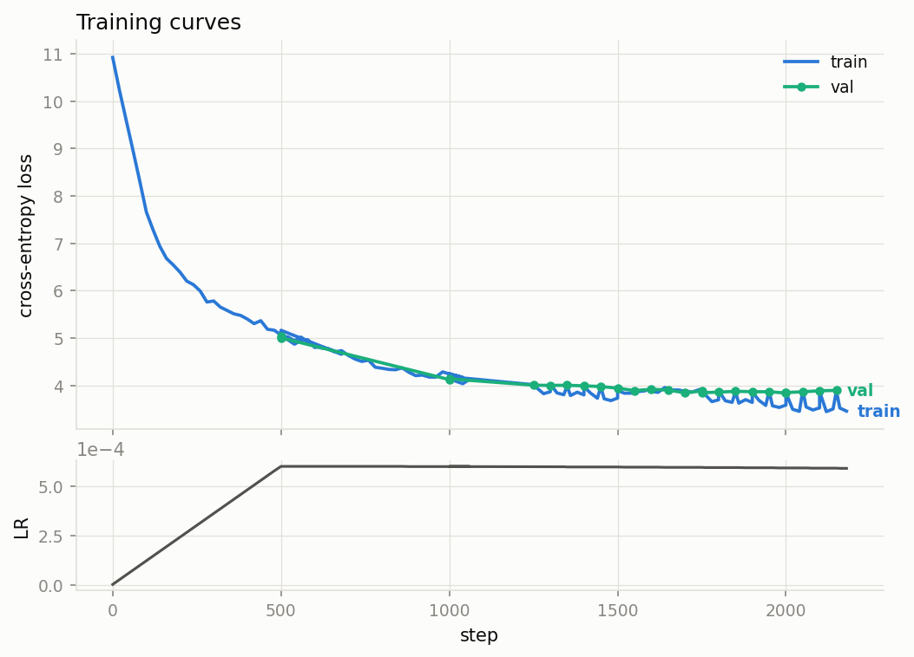
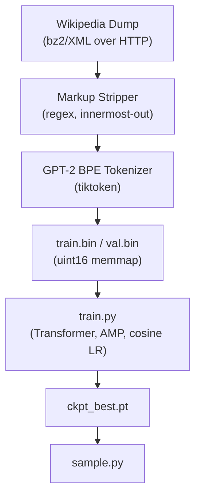
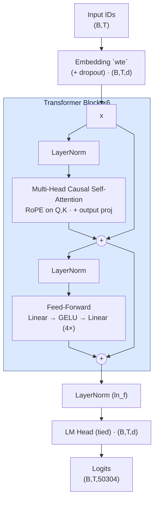
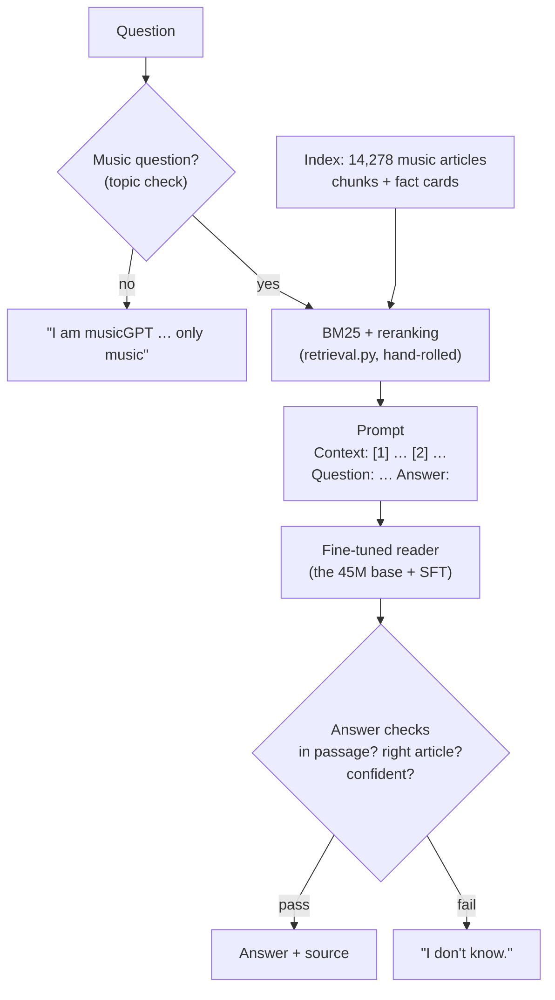

# musicGPT: a ~45M-parameter language model from scratch

**[Live demo: ask it a music question →](https://huggingface.co/spaces/eric-solak/musicGPT)**

This project was made to demonstrate that I understand what's inside an LLM, not that I can call one.

It is a decoder-only transformer built and trained end-to-end, with every core
piece written by hand instead of imported: the attention math, rotary
positional embeddings, layer norm, weight init, training loop, the
Wikipedia-markup stripper, and the search engine behind the Q&A stage.

It is built in two stages:

1. **Pretraining.** A GPT trained on 0.92B tokens of English Wikipedia, with
   music articles upweighted. It writes fluent, music-literate encyclopedic
   prose, and [makes up facts](#sample-output-from-ckpt_bestpt-with-prompt-the-electric-guitar)
   like every small language model.
2. **Fine-tuning + retrieval.** The same model fine-tuned to answer questions
   from passages, plus a hand-rolled BM25 search over Wikipedia's music
   articles. It answers from the text it retrieves and checks the answer against
   that text, and otherwise says "I don't know." On 400 held-out questions, **99%
   of the answers it gave were correct** (337 right, 3 wrong). With no passages,
   the same model got 0 right. See [Fine-tuning + retrieval](#fine-tuning--retrieval).

**Model**
- 44.6M params (18.9M non-embedding), 6 layers, 8 heads, d=512
- 512-token context length
- GPT-2 BPE tokenizer via `tiktoken` (the one external component, see [trade-offs](#what-id-do-differently-at-scale))

**Training**
- ~0.92B tokens, streamed directly from official [Wikipedia dumps](https://dumps.wikimedia.org)
- Music-related articles upweighted 3× (music and instruments are a major hobby of mine, so I wanted this model to be good at music)
- Pretrained on Colab Pro (a single L4); fine-tuned on a single A100

**Dependencies**
- `torch`, `numpy`, `tiktoken`, `requests`.

## Contents

- [Results](#results)
- [What broke](#what-broke)
- [Quickstart](#quickstart)
- [Repo layout](#repo-layout)
- [Architecture, and why](#architecture-and-why)
- [The data: Wikipedia, with a music bias](#the-data-wikipedia-with-a-music-bias)
- [Fine-tuning + retrieval](#fine-tuning--retrieval)
- [What I'd do differently at scale](#what-id-do-differently-at-scale)
- [References](#references)

## Results

Final pretraining run: 13,999 steps x 65,536 tokens/step ~= 0.92B tokens (the
~20 tokens/param budget for a 45M model), trained on Colab Pro (a single L4)
across several `--resume` sessions.



- **Init loss 10.9** = ln(50304), the uniform-guess baseline. Landing exactly
  there at step 0 is itself a correctness check (`tests/` asserts it).
- **Final loss: train 3.24, val 3.26** (val perplexity ~= 26), tracking each
  other tightly the whole run: no overfitting, despite ~1.9 passes over the
  690M-token corpus.
- **Throughput:** ~90k tokens/sec steady-state on the L4.

#### Sample output from `ckpt_best.pt` with prompt **'The electric guitar'**

> The electric guitar is a direct electric instrument; the other, which tends
> to be acoustic (not harmonically), while the rest of the material is a
> direct electric piano. In the concert band, this instrument typically
> features electric instruments.
>
> Instrumentation and programming
> The electric guitar has its own distinctive sound that involves creating
> "the dynamic range" of an ensemble or string section, being used in some
> music styles such as blues, R&B, soul-rock, black harmony, and
> electronic music. The technique is also used during recording and recording
> practice, where it can be performed with a variety of different effects. For
> example, when the performer performs in front of his audience, the vocalists
> can mimic the sounds of the instruments by placing them on one's notes (so
> their playing can produce one's own). When the singer uses fingerings from
> the solo over the strings, they can use hand pedals such as the pedal
> point.

> The electric guitar had a solid body. The main instrument the amp was on,
> with the same neck as the other instruments.
>
> **Early history (1690-1750)**
> Before that time, the amp used both its lower and upper parts. This era of
> playing became known by different names in English as "Old England Blues"
> or "New England Guitar". **In 1781, when Captain Richard Balfour died in
> London, he published his first song called The New American Blues**, which
> is still recorded today. It can be traced back to the original "Piper's
> Jug", a tune he had collected from the 1660s. From this point on, he
> experimented with the new, more acoustic guitars over a periodical, which he
> never played before so long. By then, he was producing and playing for
> **Charles Townshend's Sons Ltd.**, where he eventually established a
> publishing house at 35 Southwick Lane.

#### The bolded spans are wrong, and that's expected at this stage.

**Explanation:** A 45M-param model trained on raw Wikipedia text with a
next-token-prediction objective (no fine-tuning, no retrieval, no
fact-checking signal) learns the shape of encyclopedic prose extremely
well: era headers, specific-sounding dates, named entities, because those
are dense statistical patterns in the training corpus. Nothing in the
training objective ever rewards a true date over a merely fluent-sounding
one, so the model reproduces the form of a Wikipedia article with none of
the grounding. That's the "completion model, not a chatbot" limit from
'Honest Expectations' below.

**Errors in Output:** The electric guitar wasn't invented until the 1930s,
so a header reading "Early history (1690-1750)" is off by roughly two
centuries; "Captain Richard Balfour," "The New American Blues," "Charles
Townshend's Sons Ltd.," and "black harmony" are fluent, period-plausible
inventions that don't exist.

**The same question after stage 2** (`python ask.py "What is the electric guitar?"`):

> An electric guitar is a guitar that, unlike a standard acoustic guitar,
> requires external electric sound amplification to be heard at typical
> performance volumes.
>
> source: [Electric guitar](https://en.wikipedia.org/wiki/Electric_guitar)

## What Broke

Real failures from building the pretraining stage (the Q&A stage has [its own list](#what-broke-in-the-qa-stage)):

1. **Weight tying leaks the current token into its own logits.** My init-loss
   sanity test ("an untrained model should score ~ln(V)") failed at 3.95 vs the
   expected 4.85. Cause: I'd used `targets=inputs`, i.e. asked the model
   to predict the token it was currently looking at, and with tied embeddings,
   position *t*'s hidden state starts as `wte[token_t]`, whose dot product with
   the tied output matrix is largest at… `token_t`. Even a random model "knows"
   what token it's standing on. The test now draws targets independently, and
   `tests/test_model.py::test_init_loss_near_uniform` documents it.

2. **Vocab padding crashes the tokenizer.** I padded the embedding to 50304
   for matmul speed; `tiktoken` only knows ids < 50257. An *untrained* model
   samples near-uniformly, so the very first checkpoint's sample generation hit
   a padding id and died with `KeyError: 50296`, mid-training-run, in the
   checkpoint code path. Fix: `generate(..., vocab_limit=50257)` masks the
   padding ids to −inf before sampling. Lesson: any id the model *can* emit is
   an id your decoder must handle, and "can emit" includes rows you never train.

3. **Wikitext is not one regex.** Templates nest (`{{cite {{...}}}}`), tables
   nest, and a single greedy pattern either under-strips (markup soup in the
   training data) or eats whole paragraphs. The stripper peels innermost
   constructs in a loop, and I keep a decode-and-eyeball check on the first
   tokens of `train.bin`, since markup that survives becomes what the model learns.
   (It still had a paragraph-eating bug, found much later: see the Q&A list.)

Other failures from the same silent category: fp16 without
GradScaler underflows gradients (auto-handled here: bf16 where supported,
scaler otherwise), and eval time polluting tokens/sec metrics (timer resets
after eval). Also practical: if this repo lives in OneDrive/Dropbox, exclude
`out/` and `data/` from sync: a 1GB memmap being re-uploaded every 500 steps
while checkpoints write is misery.

## Quickstart

```bash
pip install -r requirements.txt

# 1. Build the dataset (streams the dump over HTTP; nothing else touches disk)
python data.py                            # Simple English Wikipedia, quick start
python data.py --source enwiki --parts 4  # English Wikipedia, the real run (~1B tokens)

# 2. Train (checkpoints, metrics.csv, and sample generations land in out/)
python train.py                           # ~45M "base" preset
python train.py --model small             # ~30M, faster
python train.py --resume                  # continue from out/ckpt.pt

# 3. Generate
python sample.py --prompt "The electric guitar" --temperature 0.8

# 4. Tests (CPU, <1 min): attention equivalence, causality, RoPE geometry, overfit-one-batch,
#    BM25 ranking, loss-mask alignment, SFT overfit, infobox parsing, answer checks
python -m pytest tests/ -q

# 5. Q&A stage
python retrieval.py build                 # BM25 index over enwiki parts 1-4 (music + off-topic leads)
python music_qa.py                        # infobox facts -> music questions (train / dev / test)
python qa_data.py --music-dir data/music  # SQuAD 2.0 + music questions -> data/qa_*
python finetune.py                        # from out/ckpt_best.pt -> out/finetune/
python ask.py "Who recorded Kind of Blue?"
python ask.py --eval data/music/music_test.jsonl   # precision / coverage, with vs without retrieval
```

`train.py` auto-selects CUDA and bf16 when available and falls back to fp16
(pre-Ampere) or CPU/fp32, so the repo runs anywhere, but do the real training
on a GPU. At the default settings one step processes 65,536 tokens; a mid-range
card (RTX 3060-class) does the compute-optimal 0.9B-token budget in about a
day, a 3090/4090 in a few hours.

What the pretraining commands do, end to end:



## Repo Layout

```
model.py       the transformer: LayerNorm, RoPE, causal attention, blocks, generation
config.py      model presets (debug/small/base) + pretraining and fine-tuning hyperparameters
data.py        Wikipedia dump -> plain text -> GPT-2 BPE -> train.bin/val.bin
train.py       training loop: AMP, cosine LR, grad accumulation, eval, checkpoints, samples
sample.py      generate from a checkpoint (temperature / top-k / top-p)
plot_loss.py   metrics.csv -> loss_curve.png

retrieval.py   Wikipedia -> ~120-word chunks + fact cards -> hand-rolled BM25; reranking, topic check
infobox.py     infobox wikitext -> clean facts -> one-line "fact card" passage
music_qa.py    fact cards -> music questions with exact answers (train / dev / test, split by article)
qa_data.py     SQuAD 2.0 + music questions -> loss-masked Q&A examples (data/qa_*.bin), EM/F1 metrics
finetune.py    supervised fine-tune of ckpt_best.pt into a reader (answer-only loss)
ask.py         question -> topic check -> retrieve -> answer -> answer checks; --eval scorecard
calibrate.py   confidence-threshold analysis on dev
eval/          hand-written music, paraphrase and off-topic question sets

tests/         correctness tests for the things that break silently
out/           plotting & training output (out/finetune/ for the Q&A stage)
```

## Architecture, and why

Decoder-only Transformer (GPT-style), pre-norm: the same shape as every modern LLM, at 1/10,000th scale.



| Choice | What I did | Why |
|---|---|---|
| Norm placement | **Pre-norm** (norm inside the residual branch) | Post-norm (the original 2017 layout) makes the residual stream pass through LayerNorm, which destabilizes deeper stacks; pre-norm keeps an identity path and trains without fragile warmup tuning. |
| Positions | **RoPE** (rotary embeddings), implemented by hand | Rotating Q/K channel pairs by position makes attention scores depend only on *relative* offset, no learned position table needed, and it's what Llama-class models use. `tests/` verifies both the rotation property and the relative-position property. |
| Attention | **Manual** `softmax(QKᵀ/√d + mask)V`, with an optional fused-kernel path | The hand-written path is the reference; `flash=True` dispatches to `F.scaled_dot_product_attention` for the actual training run (same math, fused kernel; a test asserts they agree to 1e-5). Softmax runs in fp32 even under bf16 autocast. |
| LayerNorm | Written out (mean/var/rsqrt), stats in fp32 | The variance of bf16 activations is where mixed-precision LMs quietly rot. |
| Embeddings | **Tied** input/output matrix | At this scale the 50304×512 embedding is 58% of all parameters, and tying saves 25M params and regularizes. (It also bit me; see [What broke](#what-broke).) |
| Vocab | GPT-2's 50257, **padded to 50304** (×64) | GPU matmuls are measurably faster when the vocab dim is a multiple of 64. (This also bit me; see [What broke](#what-broke).) |
| Init | N(0, 0.02), residual projections scaled by 1/√(2·n_layers) | Each block adds two branches to the residual stream; scaling their output init keeps activation variance ~1 at depth instead of growing linearly. |
| Optimizer | AdamW (β₂=0.95, wd=0.1 on matrices only), cosine LR + warmup, grad clip 1.0 | GPT-3 settings, standard at this scale. Weight decay is *not* applied to LayerNorm gains/biases, since decaying a normalization scale toward zero fights the normalization. |
| Data loading | `np.memmap` over a flat uint16 token stream, random windows | No DataLoader, no padding, no epochs: every offset in a continuous token stream is a valid training example, and the OS page cache does the buffering. uint16 halves the disk footprint (50257 < 2¹⁶). |

## The Data: Wikipedia, with a music bias

`data.py` streams `pages-articles` dumps straight from dumps.wikimedia.org over
HTTP → bz2 → XML, strips wiki markup with a hand-rolled set of regexes
(templates and tables are nested, so they're peeled innermost-out), and
tokenizes into a flat binary. Articles whose categories or infoboxes look
music-related (a keyword classifier: *album, song, composer, jazz, guitar,
symphon-, …*) are written **3×** to the training stream. Since training samples
random windows, duplication *is* upweighting, so no sampler changes are needed.
Validation articles are held out entirely and never duplicated, so val loss
stays honest.

**Honest expectations:** a 45M-param base model is a *completion* model, not a
chatbot. Trained on this mix it should continue "The saxophone is" with
coherent, music-literate encyclopedic prose, but it will not reliably *answer*
"who wrote Kind of Blue?". Getting question-answering behavior takes a
supervised fine-tune on Q&A pairs afterward, which is the next section.

## Fine-tuning + retrieval

The base model's problem is not fluency, it's grounding: nothing in next-token
prediction rewards a true date over a plausible one. A bigger fine-tune can't
fully fix that at 45M parameters: the model *was* pretrained on the Rubber Soul
article, but 45M weights can't store hundreds of thousands of facts reliably.
They learn what facts look like, not which ones are true. So stage 2 splits the
job the way production assistants do:

- **The facts come from Wikipedia at question time.** A hand-written BM25
  search over the same Wikipedia dump files the model was pretrained on finds
  the relevant passages.
- **The model's job is to read them.** It is fine-tuned to answer from passages
  in its context, and to say "I don't know." when they don't contain the answer.
- **Nothing it says is shown unchecked.** An answer must appear word for word in
  what it read, so a wrong answer can only be a misreading, never an invention.



### Results

**Held-out test set** (`data/music/music_test.jsonl`): 400 questions generated
from the infoboxes of articles that were split off by title hash *before*
training, so the model never saw a question about these articles.

| | correct | wrong | abstained | declined as non-music | precision | coverage |
|---|---|---|---|---|---|---|
| Same model, **no passages** | 0 | 18 | 382 | – | 0% | 5% |
| Retrieval + reader + checks | **337** | **3** | 51 | 9 | **99%** | 85% |

Precision = correct / answered; coverage = answered / asked. Retrieval put a
passage containing the gold answer in the top 2 for 385 of 400 questions
(recall@2 96%).

**Hand-written questions** (written by me, not generated, phrased the way a
person would ask):

| Set | correct | wrong | abstained / declined | precision |
|---|---|---|---|---|
| `eval/music_qa.jsonl` (42) | 21 | 6 | 15 | 78% (81% when the article is in the index) |
| `eval/music_paraphrase.jsonl` (40) | 26 | 3 | 11 | 90% |
| `eval/off_topic.jsonl` (30 non-music) | – | – | 30 declined | – |

The hand-written sets are harder than the generated one, and the remaining
errors are informative. They are almost all **role confusion inside the right
article**: the librettist named as the composer, a band member named as the lead
singer, an instrument's family named as the instrument. The answer is in the
passage, the model picked the wrong name from it, and the answer check can't
catch that because the wrong name is *also* in the passage.

**During fine-tuning** (music dev, 300 questions, greedy decoding, logged to
[out/finetune/metrics.csv](out/finetune/metrics.csv)):

| step | EM | F1 | abstains when it should | abstains when it shouldn't |
|---|---|---|---|---|
| 0 (the pretrained base) | 0.0 | 3.8 | 0% | 0% |
| 250 | 73.7 | 82.3 | 63% | 6.6% |
| 1000 | 80.7 | 87.3 | 61% | 4.2% |
| **2750 (kept)** | **85.7** | **90.2** | 68% | 3.1% |
| 4000 | 83.3 | 87.7 | 68% | 5.8% |

The base model gets 0 because it continues the prompt instead of answering. It
has never seen the `Answer:` format. Most of the gain comes in the first 250
steps: the format is easy, and reading carefully is the slow part.

### How it got there: three fine-tuning runs

| Run | Recipe | Result |
|---|---|---|
| 1 | SQuAD 2.0 as-is, including its adversarial unanswerable questions | **Failed.** Best dev F1 48.4, *below* the ~54 you get by always saying "I don't know." |
| 2 | SQuAD's answerable questions only; "I don't know." taught on simulated retrieval misses | Learned to read, but the music scorecard was 14 right and **20 wrong**: it read music passages badly and the retriever often fetched the wrong article. |
| 3 | Run 2 + 65.8k music questions from infoboxes, fact cards in the index, title-aware reranking, answer checks | The results above. |

**Why run 1 failed.** SQuAD 2.0's unanswerable questions were written by crowd
workers to *look* answerable: same paragraph, a plausible-sounding answer
nearby, one detail changed. Telling those apart takes more than a 45M model
has. So it learned the cheap version, "abstain when unsure", and it was unsure
most of the time. Those questions also teach the wrong lesson for this project:
in a retrieval system, "I don't know." should mean "the passages don't say",
not "this question is a trick". Run 2 dropped them and instead taught
abstention on simulated retrieval misses: 25% of training questions get only
look-alike passages (BM25 hard negatives) and the label "I don't know."

**Why run 2 still made things up.** Its scorecard split each wrong answer into
a retriever miss and a reader miss, and both were broken:

- **The retriever fetched the wrong article.** A question that names an
  article ("Who wrote the album Rubber Soul?") often retrieved passages from
  *other* articles that mention it in passing. Plain BM25 scores a chunk by term
  overlap and has no idea that the question names an article. On dev, the
  passage with the answer was in the top 2 only 58.5% of the time.
- **The reader had barely seen music.** SQuAD's 442 articles include about 13
  on music. Given the right passage, it answered "Who composed The Four
  Seasons?" with "The Four Seasons".

### The run 3 fixes

**Fact cards.** Infoboxes hold the cleanest facts (`artist = the Beatles`,
`composer = Georges Bizet`), and the text stripper deletes them along with every
other template. `infobox.py` parses them by hand (nested templates, `{{hlist}}`
/ `{{flatlist}}`, date templates, links, refs) into a one-line passage indexed
next to the article's text:

```
Rubber Soul (album). Artist: the Beatles. Type: studio. Released: 3 December 1965.
Genre: Folk rock, rock, pop. Label: Parlophone, Capitol. Producer: George Martin.
```

8,647 of the 14,278 music articles have one. Album, song, opera, composition,
musical-artist, instrument and person infoboxes are supported.

**Title-aware reranking.** BM25's top 200 are rescored: a chunk gets a bonus
when the question contains its article's title, scaled by how rare the title's
words are (so "Carmen" counts and "The" doesn't). Leads and fact cards of that
article get more, and list-like chunks ("Track listing…") get less. On dev,
**recall@2 went from 58.5% to 98.5%.**

**Music questions with exact answers.** `music_qa.py` turns fact cards into
questions ("Who recorded the album Rubber Soul?" → *the Beatles*), plus
definition questions from each article's first sentence. Articles are split
80/10/10 by a hash of the title, so test articles never appear in training, and
the subjects of the hand-written eval sets are excluded too. Training contexts
come from the real retriever, exactly as `ask.py` will see them, in two
variants: with the fact card and prose only. That way the model also learns to
find facts in running text. When retrieval misses, the label is "I don't
know.", which makes it a genuine retrieval miss rather than a simulated one.
65,802 examples, mixed with SQuAD.

**Answer checks** (`ask.py`). The model's answer is shown only if:

1. it appears **word for word** in the retrieved passages, which rules out
   invented names and dates;
2. if the question names an article, it comes **from that article's**
   passages, not from a neighbour's;
3. the model's **confidence** (mean token log-prob of the answer) is at least
   −0.1. That cut was tuned on the 400 dev questions before the test set was
   run. Checks 1–2 alone gave 98% precision at 94% coverage; −0.1 gives 99% at
   85%.

**Staying on topic.** The index also holds the lead section of 180,005
*non*-music articles, flagged off-topic and never shown to the model. A question
is declined if a non-music article matches it better than any music passage
("Who painted the Mona Lisa?" → the Mona Lisa article). A music-only index
can't do this, because every question finds *some* music passage. Questions
containing a music word (*album, sang, composed, …*) are always treated as
music questions.

### The final recipe

| Choice | What I did | Why |
|---|---|---|
| Prompt format | Plain text: `Context:` / `[1] title` / passage / `Question:` / `Answer:` | No new special tokens means no embedding resize (the padded vocab already bit me once). One `format_prompt()` is shared by training and `ask.py`, so the two can't drift apart. |
| Loss | **Answer tokens only.** Prompt and padding targets are −1 | `GPT.forward` already passes `ignore_index=-1` to cross-entropy, so the model needed no changes. Training on the passages too would spend capacity on re-modelling Wikipedia instead of learning to read it. |
| Data | SQuAD 2.0's answerable questions + 65.8k music questions | SQuAD teaches reading; the music questions teach reading *music* passages in the exact shape the retriever produces. |
| Context shape | Two passages: the gold one plus a BM25 **hard negative**, shuffled | At inference the retriever returns two passages, so the reader has to pick the right one. The negative is on topic but lacks the answer. |
| Abstention | 25% of questions get no gold passage and the label "I don't know." | Teaches the case that matters for retrieval: "the passages don't say". |
| Truncation | The gold passage is never cut; negatives are trimmed, then dropped | Cutting the gold passage could remove the answer while keeping its label, which is a silent way to train the model to make things up. |
| Decoding | Greedy, **no repetition penalty** | An extractive answer *is* tokens already in the context; `sample.py`'s default 1.2 penalty breaks exactly that. |
| Hyperparameters | LR 1e-4 → 1e-5 cosine, 100 warmup, 4000 × 64 examples, dropout 0.1, one A100 | The aim is to teach a format on top of what the base knows, not overwrite it. The checkpoint is kept by music dev **F1**, not by val loss. |

**The retriever: BM25, by hand.** `retrieval.py` re-streams the same enwiki
parts as pretraining, keeps the articles its classifier marks as music, and
packs their paragraphs into ~120-word chunks (two fit comfortably in 512 tokens
with the question). The inverted index is three flat numpy arrays (CSR
postings: term offsets, doc ids, term frequencies) built with one stable sort,
and a query is a scatter-add over its terms' postings and an `argpartition`.
558,465 chunks in all (including the off-topic leads), k1=1.5, b=0.75. I chose BM25 over dense embeddings because
music questions are full of names (artists, albums, composers, years), and
exact rare-term matching is what finds those. It also means no second
pretrained model.

### What broke in the Q&A stage

1. **The stripper deleted the first sentence of Rubber Soul.** A `/` inside a
   self-closing ref's name (`<ref name="Unterberger/AM" />`) made the ref
   pattern treat it as an *opening* tag, and it deleted everything up to the
   next `</ref>`: 31.5% of the article, including "Rubber Soul is the sixth
   studio album by … the Beatles". This bug was in `data.py`, so it shaped
   pretraining too, and nothing about it was visible in the loss curve. I found
   it by reading why one question failed. `tests/test_data.py` pins it.
2. **The music classifier matched substrings.** `opera` is a prefix of
   "operations" and `rock` of "rocket", so a keyword cut pulled in the US Air
   Force, the Space Race and "Military operations" categories. Both the
   retriever's classifier and the music questions now use whole words.
3. **Disambiguation pages won retrieval.** A page that lists every article
   sharing a name matches that name better than the article you meant. They
   are now skipped at index time.
4. **SQuAD's dev set has no music articles.** Run 1 and 2 were selected on dev
   F1 for general reading comprehension, not music. Run 3 selects on music dev.
5. **`{{nbsp}}` templates are deleted, not replaced with a space**, so the
   index holds "August17,1959". The model reads it fine (the dates in fact
   cards are clean), and the demo repairs it for display. A proper fix needs
   an index rebuild.

### Limits

- **Coverage.** The index holds the music articles from the first four
  English Wikipedia dump files, the same ones used for pretraining: 14,278
  articles. Acoustic guitar, Michael Jackson, Abbey Road and Thriller are not
  among them, and for those it says "I don't know." (or answers from a related
  article such as Guitar, if that clears the checks).
- **Short answers.** SQuAD-style training teaches spans: names, dates, a
  sentence. It doesn't explain or summarize.
- **Role confusion** (above) is what's left of "wrong", and the answer checks
  can't catch it.

## What I'd Do Differently At Scale

- **Train my own tokenizer.** GPT-2's BPE is the one off-the-shelf component
  here, and it's frozen to 2019 web text. At scale, vocab is a tuning knob
  (size, byte-fallback, domain coverage), and I'd train BPE on my own corpus.
- **KV cache for generation.** `generate()` recomputes the full forward pass
  per token, O(T²) total. Fine for 200-token samples during training; the
  first thing to fix for real inference.
- **Real data pipeline.** Regex-stripping wikitext is "good enough for
  pretraining", not good, and the Rubber Soul bug above is the proof. I'd use a
  proper parser, dedupe near-duplicates (Wikipedia is full of formulaic pages),
  and mix sources rather than oversampling one domain by keyword matching. Data
  quality is the highest-leverage knob at every scale.
- **Distributed training.** This repo is deliberately single-GPU. The next
  step is DDP (data parallelism), then, past ~1B params, sharded optimizers
  (ZeRO/FSDP), since the optimizer states are 2× the model in fp32.
- **Proper eval.** Val loss and eyeballing samples is fine for pretraining at
  45M. The Q&A stage already reports precision and coverage on held-out
  questions; at scale I'd add per-domain perplexity and standard benchmarks,
  tracked per checkpoint.
- **Better retrieval, then better answers.** Hybrid retrieval (BM25 plus dense
  embeddings) with a learned reranker in place of hand-set weights, so
  paraphrased questions match as well as name-heavy ones; all of Wikipedia
  instead of four dump files; and full-sentence answers with inline citations
  instead of SQuAD's short spans.

## References

- Vaswani et al., [*Attention Is All You Need*](https://arxiv.org/abs/1706.03762) (2017): the transformer
- Radford et al., [*Language Models are Unsupervised Multitask Learners*](https://cdn.openai.com/better-language-models/language_models_are_unsupervised_multitask_learners.pdf) (2019): GPT-2, decoder-only recipe, init scaling
- Su et al., [*RoFormer*](https://arxiv.org/abs/2104.09864) (2021): rotary position embeddings
- Hoffmann et al., [*Training Compute-Optimal LLMs*](https://arxiv.org/abs/2203.15556) (2022): the ~20 tokens/param rule used to size the token budget
- Rajpurkar et al., [*Know What You Don't Know: Unanswerable Questions for SQuAD*](https://arxiv.org/abs/1806.03822) (2018): SQuAD 2.0
- Robertson & Zaragoza, [*The Probabilistic Relevance Framework: BM25 and Beyond*](https://doi.org/10.1561/1500000019) (2009): BM25
- Lewis et al., [*Retrieval-Augmented Generation for Knowledge-Intensive NLP Tasks*](https://arxiv.org/abs/2005.11401) (2020): RAG
- Karpathy's [nanoGPT](https://github.com/karpathy/nanoGPT): the spiritual ancestor of every small-GPT repo, including this one; the memmap batching trick is his
